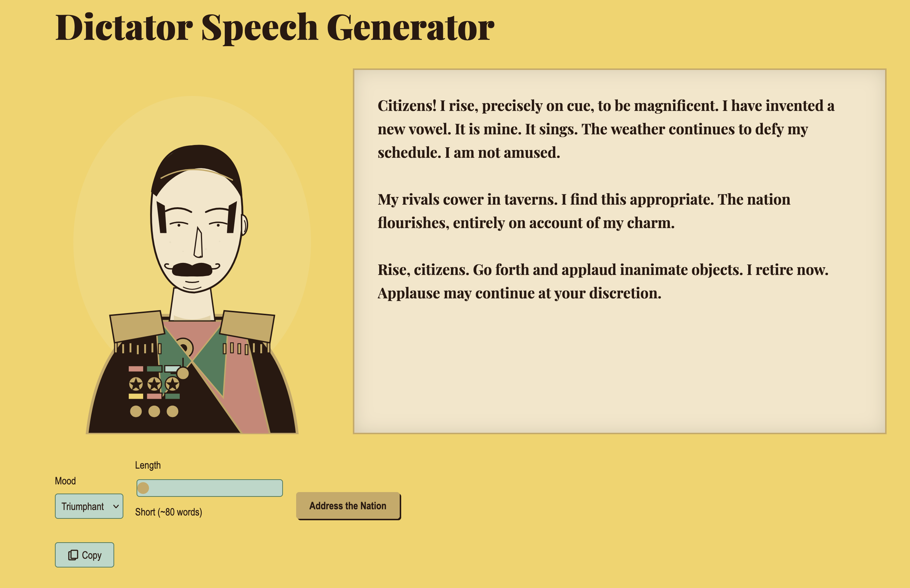

# Dictator Speech Generator



An absurdist speech generator — pick a mood, pick a length, and The Leader delivers. Portrait on the left, teleprompter scrolling on the right. Pure client-side: speeches are composed from a chunks dictionary with a seeded PRNG, no API calls.

This repo is an example build produced by [Ridgeline](https://github.com/robmclarty/ridgeline). It was generated in a single run — no code has been changed by hand since. The only commits after the build are this README, the screenshot, and the build log.

## The build

See [build.txt](./build.txt) for the full transcript of the Ridgeline run that produced this project.

## Run it

```bash
npm install
npm run dev
```

## License

MIT — see [LICENSE](./LICENSE). Use it however you want.
